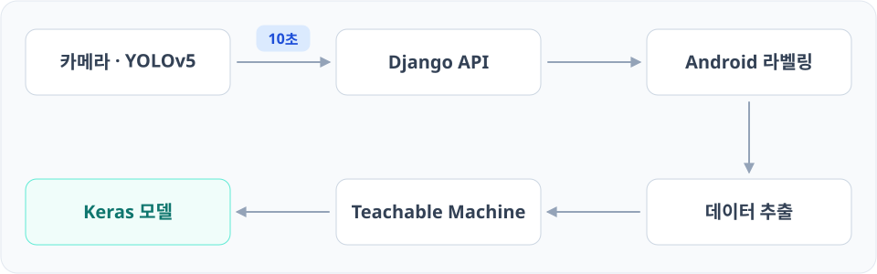
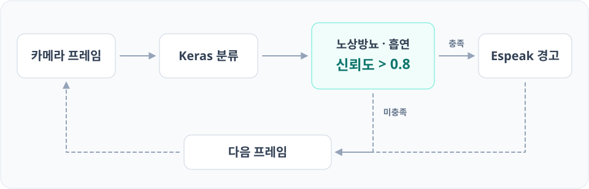

# Urination Detector

**카메라 수집 → 이미지 라벨링 → 모델 학습·현장 추론을 연결한 IoT 프로젝트**


## 데모 영상

https://github.com/user-attachments/assets/79a5bd77-b731-4802-b05b-29e4f0ed0a19

Raspberry Pi 현장 시연 · [원본 영상](https://drive.google.com/file/d/1RpNKm9yhZ8sdQCA66H22pW5s6PCMZ65D/view)

**개인 프로젝트** · 조동휘: 앱·서버·수집 로직·추론 연동

[기능 테스트 영상](https://drive.google.com/file/d/1I0cp2PDVmjkZuUJ_DR5EsddChgGyegyf/view) · [구현 구조](#구현-구조) · [프로젝트 구조](#project-structure) · [실행 조건](docs/SETUP.md)

## 프로젝트 개요


- 노상방뇨·흡연 분류와 음성 경고 프로토타입 구현
- 이미지 수집 → 서버 저장 → Android 라벨링 → 모델 학습·현장 추론 연결
- YOLOv5·Teachable Machine 활용, 수집 조건·API·앱·추론 연동 직접 구현

## 구현 구조

### 데이터 준비 흐름

<picture>
  <source media="(max-width: 1000px)" srcset="docs/assets/data-flow-mobile.svg">
  
</picture>

### 현장 추론 흐름

<picture>
  <source media="(max-width: 1000px)" srcset="docs/assets/inference-flow-mobile.svg">
  
</picture>

- 데이터 준비·현장 추론은 별도 실행, 라벨링·학습은 수동 진행

## 핵심 구현

### 01. 이미지 수집

- 사람 감지 상태가 10초 이상 이어지면 이미지 전송
- 320×240 크기로 축소 후 서버 업로드
- 동일 인물 추적·정지 자세 판별은 미구현

[수집 조건과 업로드](vision/yolov5/change_detection.py) · [탐지 루프 연결](vision/yolov5/detect.py)

### 02. 라벨링 API·Android 앱

- Django로 이미지·메타데이터 저장, 미분류 조회·라벨 변경 API 구현
- Java·`HttpURLConnection`으로 Android 조회·분류 화면 연결

| 값 | 의미 |
| :--- | :--- |
| `UCF` | 미분류 · 업로드 기본값 |
| `URN` | 노상방뇨 |
| `SMK` | 흡연 |
| `ETC` | 기타 |

[데이터 모델](server/blog/models.py) · [서버 API](server/blog/views.py) · [Android 앱](android/app/src/main/java/com/example/urnationdetector/MainActivity.java) · [API 상세](docs/API.md)

<details>
<summary>개발 당시 Android 라벨링 화면 보기</summary>


*개발 당시 시연 화면*

</details>

### 03. 현장 추론·음성 경고

- `keras_Model.h5`·`labels.txt`로 카메라 프레임 분류
- 노상방뇨·흡연으로 분류되고 **신뢰도 > 0.8**이면 Espeak 경고 출력
- 0.8은 경고 임계값이며 정확도 지표와 별개

[전처리·추론·경고 코드](inference/run_classifier.py)

<a id="project-structure"></a>

## 📂 프로젝트 구조

주요 파일 기준

```text
UrinationDetector/
├── vision/yolov5/  # 사람 감지·이미지 수집
│   ├── change_detection.py  # 수집 조건·이미지 전송
│   └── detect.py  # 탐지 루프 연동
├── server/  # 이미지 저장·조회·라벨 API·의존성
├── android/  # Android 라벨링 앱
├── tools/dataset_export/
│   └── export_images.py  # 학습 데이터 내려받기
├── inference/  # Raspberry Pi 현장 추론
│   └── run_classifier.py  # 분류·음성 경고
├── .env.example  # 로컬 설정 예시
└── docs/  # 실행 조건·API·검증 기록
```

- Android 식별자: `com.example.urnationdetector` 유지
- YOLOv5 외부 코드·라이선스, 기존 모델·이미지 보존

## 실행과 검증

- [실행 안내](docs/SETUP.md): 서버·앱·카메라·모델·음성 환경 설정
- [검증 기록](docs/VALIDATION.md): Django·파이프라인 테스트, Android 빌드 확인

## 현재 한계와 다음 개선

- API 접근 권한, 미분류 데이터 없음·정렬 처리 보강 필요
- 통신 재시도·경고 반복 간격·오탐 측정 필요
- 실제 장비 통합·야외 정확도·처리 속도는 미검증

## 프로젝트 자료

| 자료 | 내용 |
| :--- | :--- |
| [연구 문서](https://drive.google.com/file/d/1f6kGLwl4XqyBqUO4NgoJRzLFDGW4-bWS/view) | 프로젝트 설계와 이론 |
| [기능 테스트 영상](https://drive.google.com/file/d/1I0cp2PDVmjkZuUJ_DR5EsddChgGyegyf/view) | 분류와 경고 동작 |
| [현장 설치 영상](https://drive.google.com/file/d/1RpNKm9yhZ8sdQCA66H22pW5s6PCMZ65D/view) | Raspberry Pi 현장 시연 |
| [발표 자료](https://docs.google.com/presentation/d/1J1sP0SbMh7VCPl-DiFDkMHlJIGEdiAfq/edit) | 전체 시스템 요약 |

